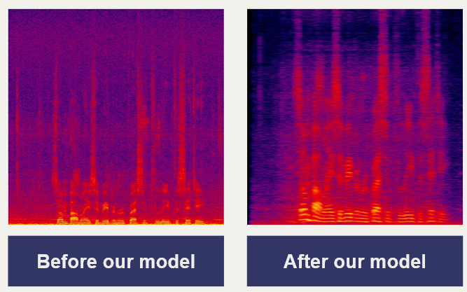
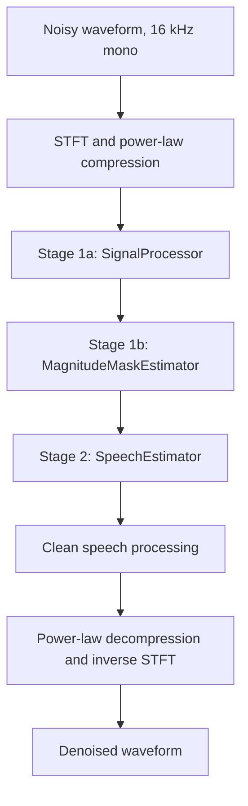

# Project Echo: A Speech Enhancement Deep Learning Model

A deep learning model that removes background noise from speech audio, as part of our aim to create an AI-powered hearing aid.



## Project Structure

```
project-echo-model/
├── src/
│   ├── features.py
│   └── modules/
│       ├── subband/          # splitter, GRU, FC layers, and mask estimator modules
│       ├── conv_block/       # depthwise conv, feature reorientation (unimplemented), FGRU, signal processor
│       ├── clean_speech/     # speech estimator
│       └── denoiser.py       # denoiser model pipeline
├── scripts/
│   ├── inference.py          # runs the model on an audio file
│   └── test_pipeline.py      # tests the pipeline on mock audio
├── train.py                  # training script
├── audio_utils.py            # load_audio / save_audio helpers, TARGET_SR
├── models/                   # trained weights (denoiser_v1.pth currently only trained on subset of dataset, denoiser.pth to be overridden)
├── data/                     # datasets (not committed)
├── assets/                   # images (for README)
├── requirements.txt
└── README.md
```

## Installation
```bash
git clone https://github.com/benofthebens/project-echo-model.git
cd project-echo-model
python -m venv .venv             # create virtual environment
source .venv/Scripts/activate    # activate environment (Git Bash)
pip install -r requirements.txt  # load dependencies into virtual environment
```

## Data
Download the dataset from Kaggle (link in [References](#references)) and extract it so that the folders are located inside `data/`:

```
data/
├── noisy_trainset_wav/
├── clean_trainset_wav/
├── noisy_testset_wav/
└── clean_testset_wav/
```

Denoised static audio samples will be stored in `data/denoised`. `data/` is gitignored, so the dataset must be downloaded individually by each user.

## Execution

Run all commands from the project root.

### Inference
```bash
python -m scripts.inference
```

Edit `INPUT_FILE` and `OUTPUT_FILE` at the bottom of `scripts/inference.py`.
The input is converted to 16 kHz mono internally, and the output is saved at
16 kHz. The pretrained weights are loaded from `models/denoiser.pth`.

### Training

```bash
python -m train
```
By default, this script trains the model on the first 100 files (`MAX_FILES`) of the training set for 10 `EPOCHS` and prints the average loss per epoch. The aim this year is to train on the full set of the training data. Weights are saved to `models/denoiser.pth`, overwriting the existing model (the initial version of the model has been backed up under `models/denoiser_v1.pth`).

## Technical Overview
Our model has been adapted from Shetu et al. ([2023](https://doi.org/10.48550/arXiv.2312.08132))'s Ultra Low Complexity Deep Learning architecture, and trained on the Noise Cancellation dataset ([Nagamally, 2023](https://www.kaggle.com/datasets/srujannagamally/noise-cancellation)) from Kaggle.

### Architecture



### Feature extraction

The waveform is converted to a complex STFT (512-point FFT, hop 256, 257 bins). Power-law compression (`alpha=0.3`) is applied to the real and imaginary parts separately, and compressed magnitude and phase are derived from them.

### Stage 1a: `SignalProcessor`

Input: compressed magnitude `(B, 1, 257, T)`.

- Four depthwise convolution blocks (channels 1 → 128), with 2x2 max pooling after blocks 2-4 (frequency 257 → 32)
- `FGRU`: per frequency bin, a bidirectional GRU over time (64 hidden units) between two linear layers, with ReLU
- Pointwise convolution (128 → 64 channels)

### Stage 1b: `MagnitudeMaskEstimator`

The stage 1a output `(B, 64, 32, T')` is flattened to `(B, 64, 32·T')` and passed through:

- `LearnableSubbandSplitter`: two parallel learnable 1D convolutions (kernel size 3) with ReLU, producing two subband feature maps
- `SubbandedTemporalGRU`: one unidirectional GRU per subband (2 layers, 128 hidden units)
- `FullyConnectedLayers`: three 1x1 `Conv1d` layers, the first two with `BatchNorm` and ReLU, followed by a sigmoid to bound the mask to `[0, 1]`

The output is averaged over the pooled frequency axis and interpolated back to `T` frames, giving a `(B, 1, 257, T)` mask.

### Stage 2: Complex speech estimation

1. **Intermediate features:** the mask and noisy phase form a real/imaginary pair, `mask·cos(phase)` and `mask·sin(phase)`, stacked into `(B, 2, 257, T)`.
2. **`SpeechEstimator`:** two `1x3` convolutions (2 → 32 → 32 channels, ReLU) and a pointwise convolution (32 → 2) output a complex mask `M`.
3. **Clean speech reconstruction**, where $|X_{comp}|$ is the compressed noisy magnitude:

   $$\hat{S} = |X_{comp}| \cdot \tanh(|M|) \cdot e^{j(\phi_{noisy} + \phi_M)}$$

### Output

$\hat{S}$ is power-law decompressed (exponent $1/\alpha$) and converted to a waveform with an inverse STFT, trimmed to the input length. A fixed gain of 132 is applied in `Denoiser.forward`.

### Key settings

| Setting | Value |
|---|---|
| Sample rate | 16 kHz (`TARGET_SR` in `audio_utils.py`) |
| STFT | 512-point FFT, hop 256, 257 bins |
| Power-law exponent (`alpha`) | 0.3 |
| Mask estimator GRUs | 2 subbands, 2 layers, 128 hidden units, unidirectional |
| FGRU | 1 layer, 64 hidden units, bidirectional |

### Tensor shapes

| Stage | Output shape |
|---|---|
| Compressed magnitude spectrogram | `(B, 1, 257, T)` |
| `SignalProcessor` | `(B, 64, 32, T')` |
| `MagnitudeMaskEstimator` (before reshape) | `(B, 257, 32·T')` |
| Magnitude mask (after averaging and interpolation) | `(B, 1, 257, T)` |
| Intermediate features | `(B, 2, 257, T)` |
| `SpeechEstimator` (complex mask) | `(B, 257, T)` complex |
| Output waveform | `(B, samples)` |

`T'` is the number of frames after three 2x max-pooling steps (roughly `T / 8`).

## Known Limitations

- **Under-trained model.** The model (as of November 2026) has been trained on only the first 100 of the 11K+ training samples, so is likely biased. More training on the full set is planned.
- **Audio I/O uses `soundfile`**, not `torchaudio.load/save`, to temporarily avoid the TorchCodec and FFmpeg dependency on Windows.
- **Not real-time.** The mask estimator GRUs run over a flattened frequency-time sequence, so each output depends on the whole clip. The stage 1a convolutions (symmetric 3x3 kernels, 2x2 max pooling) also need future frames.

## References

- Nagamally, S. (2023) *Noise Cancellation*. Kaggle. Available at: https://www.kaggle.com/datasets/srujannagamally/noise-cancellation (Accessed: 29 October 2025).

- Shetu, S.S., Chakrabarty, S., Thiergart, O. and Mabande, E. (2023) 'Ultra low complexity deep learning based noise suppression', *arXiv preprint* arXiv:2312.08132. Available at: https://doi.org/10.48550/arXiv.2312.08132 (Accessed: 3 November 2026).


